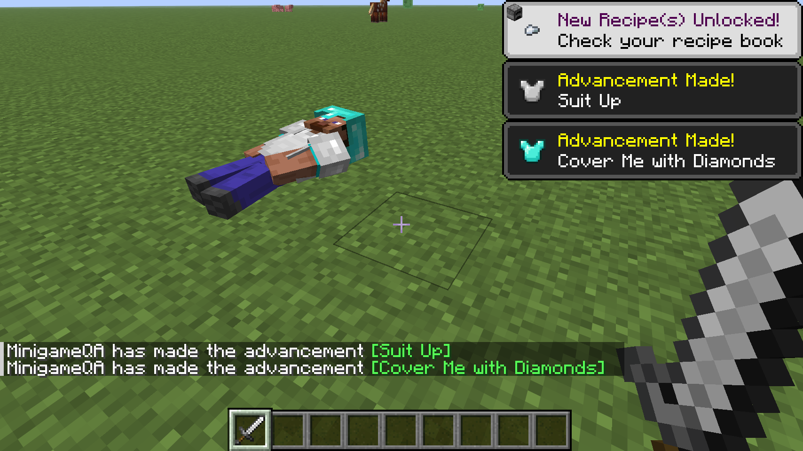

# RemoteRagdoll — Fabric

[`bettermodel/`](../bettermodel) 방식(스킨 6조각 + 관절 5개, Jolt 물리)을 Fabric 서버 모드로 옮긴 것.
Bukkit API 를 쓰지 않고, 조각은 BetterModel Fabric 의 패킷 API 로만 그린다(서버 전용, 클라이언트 모드 불필요).



## 요구 사항

- Minecraft 26.3, Fabric Loader 0.20.1+, Fabric API, Java 25
- [BetterModel Fabric](https://modrinth.com/plugin/bettermodel) 3.6.0 과 그 의존 모드(Fabric Language Kotlin, Polymer resource pack 등).
  없으면 모드는 뜨지만 래그돌은 꺼진다(로그에 사유 출력).
- JVM 옵션 `--enable-native-access=ALL-UNNAMED`

## Jolt 네이티브

[jolt-jni](https://github.com/stephengold/jolt-jni) 1.0.0 (`ReleaseSp`) 네이티브 8종이 jar 안에 jar-in-jar 로 들어 있고,
첫 실행 때 OS/아키텍처에 맞는 것 하나만 `config/remoteragdoll/natives/` 로 풀린다.

| OS | 아키텍처 | 아티팩트 |
|---|---|---|
| Linux | x64 / x64+FMA / ARM64 / ARM32hf | `Linux64`, `Linux64_fma`, `Linux_ARM64`, `Linux_ARM32hf` |
| macOS | x64 / ARM64 | `MacOSX64`, `MacOSX_ARM64` |
| Windows | x64 / x64+AVX2 | `Windows64`, `Windows64_avx2` |

기본은 호환성이 넓은 기본판이다. `-Dremoteragdoll.jolt.variant=avx2`(Windows) 또는 `fma`(Linux)로 빠른 판을 고를 수 있다.
Windows ARM64 네이티브는 넣지 않았다.

## 쓰는 법

- 플레이어가 죽으면 그 자리에 시체가 남는다(`on-death`).
- 걸어서 밀치기, 맨손/무기 휘두르기로 걷어차기(`kick-strength`).
- `/ragdoll [player]` — 그 플레이어 모습의 시체를 그 자리에 떨어뜨린다.
- `/ragdoll at <x> <y> <z> [world]`, `/ragdoll clear`, `/ragdoll where`(조각 좌표 출력, 디버그용) — 게임마스터 권한
- 설정: `config/remoteragdoll.properties` (첫 실행 때 기본값이 복사된다)

다른 모드에서는 `kr.gcb.ragdoll.api.Ragdolls`(`ready` · `drop` · `middle` · `remove`)만 부르면 된다. `./gradlew publishToMavenLocal` 로 `kr.gcb.ragdoll:remoteragdoll-fabric` 이 올라간다.

내부 API 를 직접 쓰려면 `kr.gcb.dungeon.model.Corpses`, `kr.gcb.dungeon.physics.{PhysicsWorld, Shoves}` 를 그대로 쓴다.
좌표·벡터는 `kr.gcb.ragdoll.compat.{Location, Vector}`.

## Bukkit 판과 다른 점

- `EntityPuppet`(실제 디스플레이 엔티티 폴백)을 뺐다. 모자·손에 든 아이템도 패킷 퍼펫이다.
- 플러그인 설정(yml) 대신 properties 파일.
- 주먹질 감지와 리소스팩 로드 감지는 믹스인(`PunchMixin`, `ResourcePackMixin`).
- BetterModel 3.5.1 → 3.6.0 (Fabric 판).

## 빌드

```
./gradlew build      # build/libs/RemoteRagdoll-Fabric-1.0.0+26.3.jar
./gradlew runServer  # 개발 서버 (BetterModel 은 localRuntime 으로 올라온다)
```

## 검증 상태

- 확인: macOS ARM64 개발 서버에서 Jolt 로드, `/ragdoll` 과 사망 시 시체 생성, 스킨·갑옷 표시, `/ragdoll clear`, 걸어서 밀치기(약 5블록 이동)와 휘둘러 걷어차기(약 1블록 이동, `/ragdoll where` 좌표로 확인).
- 미확인: Windows·Linux 네이티브 실제 로드(패키징만 확인), 여러 명이 동시에 볼 때, 사망자 숨김 패킷.
